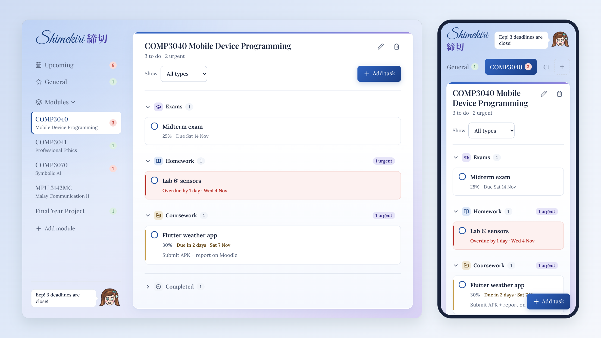

# Shimekiri 締切

A minimal assignment and deadline tracker for university students. *Shimekiri*
is Japanese for "deadline". Tasks are kept in tabs for each module, sorted by due
date and grouped by type. Shimekiri-chan, a Y2K-style mascot with a butterfly clip, keeps an eye on what's
coming up.

**Try it:** https://sophieaoi.github.io/shimekiri-chan/



## Features

- **Tabs:** a General tab, one tab per module, and an Upcoming tab with a month
  calendar of every deadline across all tabs. Pick a day to see its tasks, and Add task
  fills in that date. Overdue work is listed above the calendar so it can't hide in an
  earlier month. You can add, rename and delete module tabs, and fold them
  away under Modules. Each tab shows how many tasks are left: green normally, red
  when something is urgent.
- **Task types:** Exam, Homework and Coursework, each with its own coloured tag and
  icon. Each tab groups tasks into collapsible sections by type, with a filter to show
  one type at a time.
- **Deadlines at a glance:** tasks sort by due date automatically. Overdue tasks and
  tasks due within 3 days are highlighted in colour and in words ("Overdue by 2 days",
  "Due tomorrow"). A collapsed section still shows how many urgent tasks it holds.
- **Quick actions:** complete a task with one tap, and it moves into a collapsed
  Completed section at the bottom of the tab. Delete with one tap. Both can be undone
  from the toast that appears.
- **Shimekiri-chan:** relaxed when nothing is close, nervous when deadlines approach,
  happy for a moment whenever you finish something.
- **Works offline and keeps your data:** everything is saved in your browser's
  localStorage. Nothing is sent anywhere.
- **Accessible:** keyboard-friendly tabs and dialogs, 44px touch targets, WCAG AA
  contrast checked with axe, and support for reduced motion.

Each task has a title, type, due date, optional notes, optional weighting (%) and a
done status.

## Getting started

You need [Node.js](https://nodejs.org/) 22.12 or newer.

```bash
git clone https://github.com/SophieAoi/shimekiri-chan.git
cd shimekiri-chan
npm install
npm run dev
```

Then open the address it prints, usually http://localhost:5173. To try it on your
phone, run `npm run dev -- --host` and open the network address on a phone connected
to the same Wi-Fi.

| Command | What it does |
|---|---|
| `npm run dev` | Start the development server with hot reload |
| `npm run build` | Type-check and build into `dist/` |
| `npm run preview` | Serve the production build locally |
| `npm test` | Run unit and component tests (Vitest) |
| `npm run test:e2e` | Run browser tests, including an axe accessibility scan (Playwright) |

The first time you run the browser tests, install their browser with
`npx playwright install chromium`. If you already have Google Chrome, you can skip
that and run `PLAYWRIGHT_CHANNEL=chrome npm run test:e2e` instead.

### Deploying

Every push to `main` runs the tests, builds the app and publishes it to GitHub Pages
([workflow](.github/workflows/deploy.yml)). The first time, enable it under
**Settings → Pages → Source: GitHub Actions**.

`npm run build` produces a static site in `dist/` with relative asset paths, so it
also works on any other static host.

## Tech stack

React 19, TypeScript in strict mode and Vite. Styling uses plain CSS Modules with
design tokens, and icons come from Lucide. Tests use Vitest, Testing Library and
Playwright with axe-core. There is no backend and no state library: a reducer and a
context are enough at this size.

## Project structure

```
src/
  types.ts, constants.ts   Domain types and tunable thresholds (e.g. what "due soon" means)
  data/seed.ts             Modules created on first run
  lib/                     Pure logic, no React: dates, sorting, urgency, mood, storage, validation
  state/                   Reducer and TrackerContext (actions, persistence, undo toasts, mood)
  hooks/                   useToday (keeps "today" fresh), usePrefs (open tab, collapsed sections)
  components/              UI: Mascot, Tabs, panels, task sections and rows, dialogs, toast
  styles/                  Colour, spacing and font tokens plus shared base styles
e2e/                       Playwright browser tests
docs/                      Build plan and screenshots
```

## Design notes

- **Due dates are calendar days, not timestamps.** They are stored as `YYYY-MM-DD`
  and compared in your local timezone, so a task due "Friday" never shows as Thursday
  around midnight.
- **Your data is protected.** Saved data is validated when it loads. If it can't be
  read, it is copied to a backup key rather than overwritten. If saving fails (for
  example, storage is full), a warning appears instead of changes silently vanishing.
- **Multiple tabs stay in sync.** If Shimekiri is open in two browser tabs, a change
  in one shows up in the other instead of being overwritten.
- **Accent colours are for decoration only.** All text uses the deep shades, so the
  blue palette stays readable.

## About

This is a vibe-coded project.

## Licence

No licence has been chosen yet, so all rights are reserved by default.
